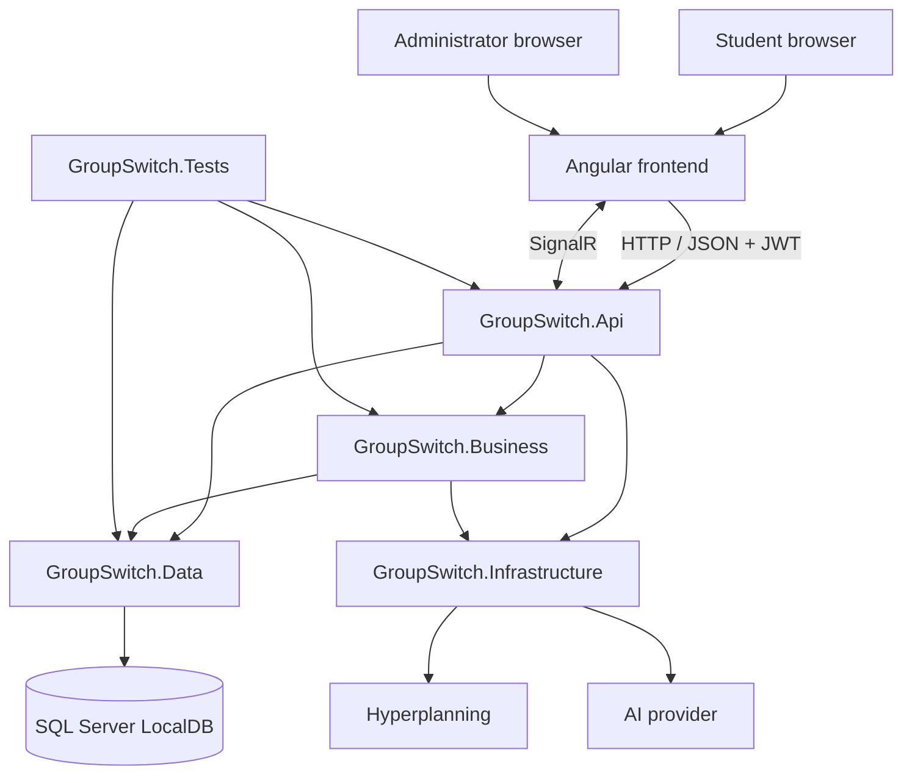
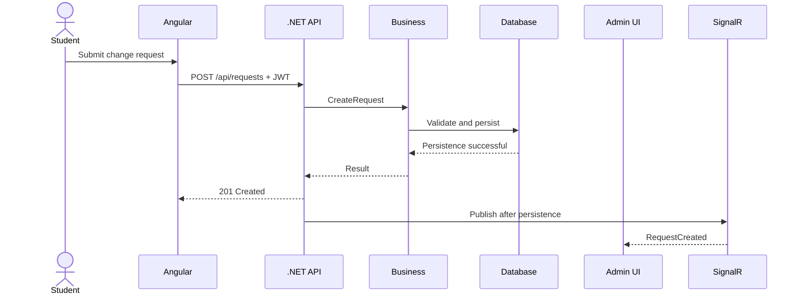
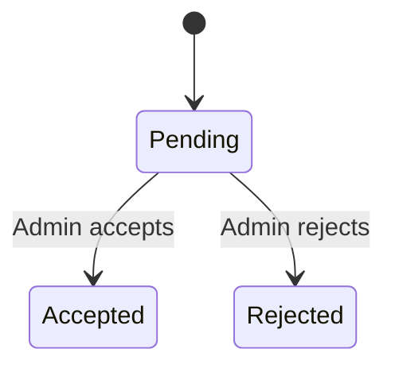
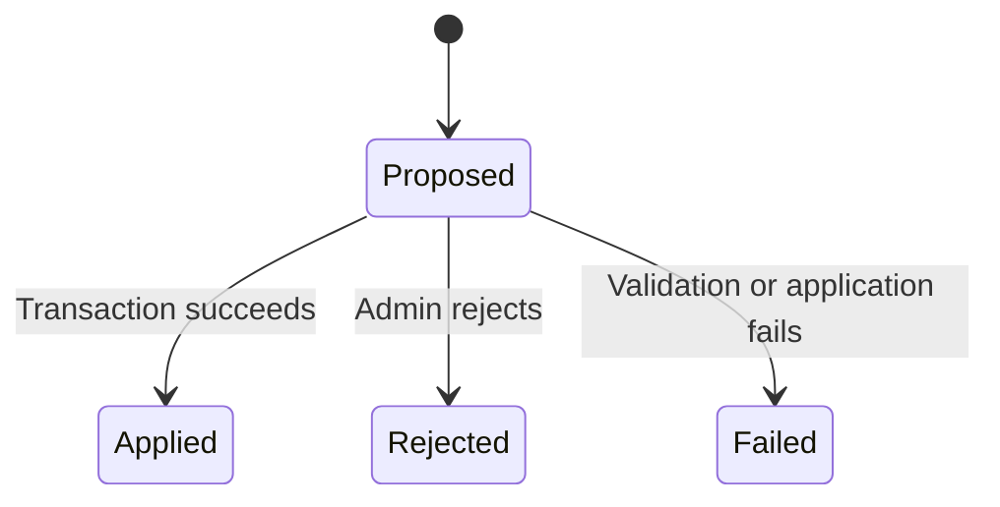
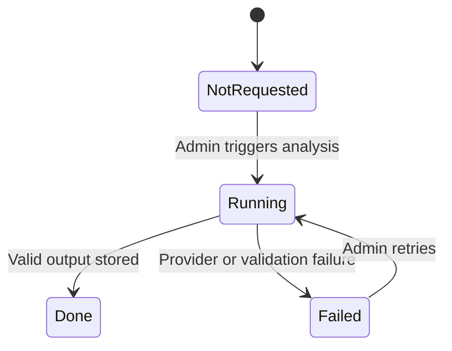
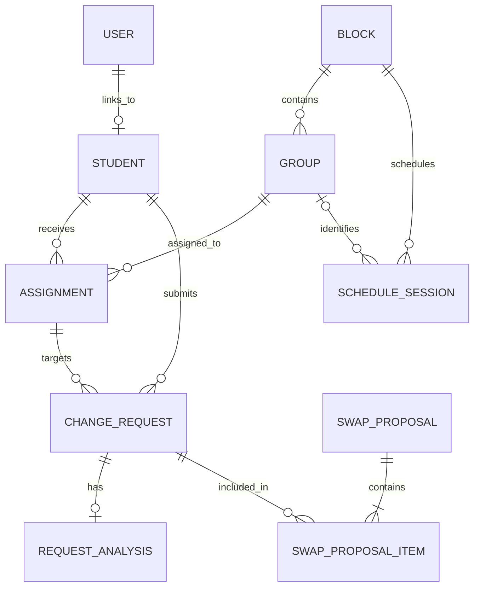
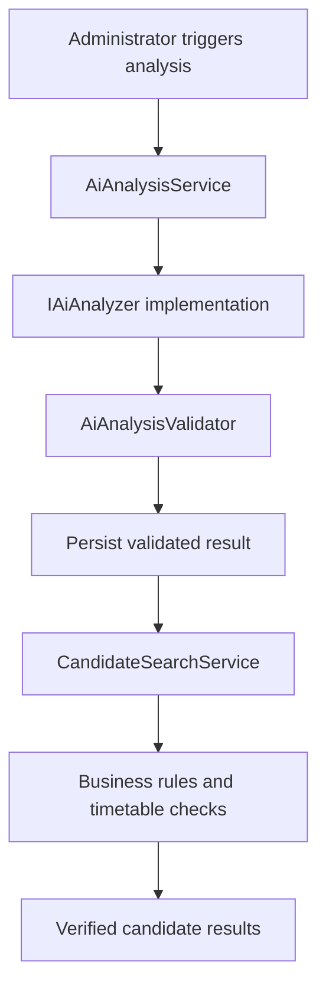

# GroupSwitch

**A web application for managing academic group assignments, student group-change requests, and multi-student exchange cycles.**

> **Project status:** Architecture and implementation plan. Features described in this document are planned unless explicitly marked as implemented in the repository.

## Project at a glance

| Item | Choice |
|---|---|
| Project type | Academic software project — HELB |
| Frontend | Angular, TypeScript, CSS |
| Backend | ASP.NET Core Web API, C# |
| Architecture | Layered architecture with separated responsibilities |
| Persistence | Entity Framework Core + SQL Server LocalDB |
| Authentication | JWT Bearer |
| Authorization | `Student` and `Admin` roles |
| Real-time updates | ASP.NET Core SignalR |
| Automated tests | xUnit + SQLite in-memory |
| Timetable source | Hyperplanning |
| AI assistance | Explicitly triggered by an administrator |
| Main API format | HTTP/JSON |

---

## 1. Project overview

GroupSwitch is a web application designed to manage students, academic blocks, groups, group assignments, and requests to change groups.

The application centralizes administrative operations, protects student requests, and helps administrators identify valid exchange cycles between multiple students.

It provides two main workspaces:

- **Student workspace:** view personal assignments, submit change requests, and track request statuses.
- **Administrator workspace:** manage academic data, import records, process requests, search for exchanges, inspect timetables, trigger AI analysis, and export data.

The .NET backend is responsible for security, business rules, data integrity, and integration with external services. Angular provides the user interface and communicates with the backend through the REST API.

## 2. Project objectives

1. Manage students, academic blocks, groups, and group capacities.
2. Import data from CSV files and report invalid rows, duplicates, and unknown references.
3. Manage student assignments to groups.
4. Allow a student to request a change to one specific assignment.
5. Allow administrators to accept or reject requests.
6. Find exchange cycles involving at least three students.
7. Apply exchanges atomically: either every change succeeds or none does.
8. Import and use timetable data retrieved from Hyperplanning.
9. Detect timetable conflicts using deterministic C# logic.
10. Let an administrator explicitly trigger AI analysis of a free-text request reason.
11. Display candidate solutions whose validity has been checked by the backend.
12. Broadcast relevant changes in real time through SignalR.
13. Export authorized data as CSV and PDF files.

## 3. Actors and permissions

### 3.1 Student (`Student`)

A student can:

- Sign in and sign out.
- View their own assignments.
- Create a change request for an assignment they own.
- View only their own requests and their statuses.
- Receive notifications related to their requests.

A student cannot:

- Manage students, blocks, or groups.
- Trigger or view administrator-only AI analysis.
- Access administrative data.
- Accept or reject requests.
- Change their own role or the identity associated with their account.

### 3.2 Administrator (`Admin`)

An administrator can:

- Manage students, blocks, groups, and group capacities.
- Manage assignments.
- Import CSV data and review import reports.
- Manage virtual categories.
- Trigger an initial assignment distribution.
- Review, accept, and reject requests.
- Trigger AI analysis and inspect its results.
- Review candidate solutions and timetable conflicts.
- Search for, validate, and reject exchange cycles.
- Trigger timetable imports.
- Export authorized data.

### 3.3 External systems

**Hyperplanning** is the source of timetable information. Retrieved data must be validated and normalized before it is used by the application.

**The AI service** structures the free-text reason supplied with a request. It is not an authoritative timetable source and does not make final business decisions.

---

## 4. High-level architecture



This diagram describes the intended logical architecture. Exact C# project references must be configured deliberately during implementation.

### 4.1 Separation of responsibilities

- **Angular:** user interface, forms, navigation, and HTTP calls.
- **Api:** HTTP endpoints, authentication, authorization, request validation, and application configuration.
- **Business:** business rules, use-case orchestration, and service interfaces.
- **Data:** persistence entities, EF Core `DbContext`, database configuration, and migrations.
- **Infrastructure:** concrete implementations of external and technical services.
- **Tests:** automated verification of business rules, persistence, and access control.

### 4.2 Why add an Infrastructure project?

The planned application needs concrete implementations for timetable scraping, AI analysis, and exports. Add the following project to the solution:

`backend/GroupSwitch.Infrastructure/`

It will contain implementations such as `HyperplanningScraper`, the selected `IAiAnalyzer` implementation, and CSV/PDF exporters.

Infrastructure must not depend on API controllers. Interfaces for these capabilities should live in Business where appropriate, allowing implementations to be replaced in tests.

### 4.3 Dependency rules

The intended dependency direction is:

- `GroupSwitch.Api` calls Business services and configures the application's technical dependencies.
- `GroupSwitch.Business` defines use cases, business rules, and relevant interfaces.
- `GroupSwitch.Data` implements persistence using EF Core.
- `GroupSwitch.Infrastructure` implements integrations and technical services.
- `GroupSwitch.Tests` references the projects required for the tests it runs.

Avoid circular dependencies. Business must not depend on API controllers, SignalR, EF Core, or a specific AI provider. If the final implementation requires a stricter Clean Architecture design, use dependency inversion through interfaces and adjust the project references accordingly.

---

## 5. Repository structure

The following is the target structure. Folders and files that do not yet exist should be created when their responsibilities are implemented.

```text
GroupSwitch/
├── GroupSwitch.sln
├── README.md
├── .gitignore
│
├── backend/
│   ├── GroupSwitch.Api/
│   │   ├── Controllers/
│   │   ├── Hubs/
│   │   ├── DTOs/
│   │   ├── Extensions/
│   │   ├── Properties/
│   │   ├── Program.cs
│   │   ├── appsettings.json
│   │   └── appsettings.Development.json
│   │
│   ├── GroupSwitch.Business/
│   │   ├── Interfaces/
│   │   ├── Services/
│   │   ├── Rules/
│   │   ├── Scheduling/
│   │   ├── Swaps/
│   │   └── AI/
│   │
│   ├── GroupSwitch.Data/
│   │   ├── Entities/
│   │   ├── Configurations/
│   │   ├── Context/
│   │   ├── Migrations/
│   │   └── Seed/
│   │
│   ├── GroupSwitch.Infrastructure/
│   │   ├── Hyperplanning/
│   │   ├── AI/
│   │   ├── Export/
│   │   └── DependencyInjection.cs
│   │
│   └── GroupSwitch.Tests/
│       ├── Unit/
│       ├── Integration/
│       ├── Security/
│       ├── Scheduling/
│       └── Swaps/
│
├── frontend_angular/
│   ├── package.json
│   ├── angular.json
│   └── src/
│       ├── environments/
│       ├── styles.css
│       └── app/
│           ├── core/
│           ├── layout/
│           ├── shared/
│           ├── features/
│           │   ├── auth/
│           │   ├── student/
│           │   └── admin/
│           ├── app.routes.ts
│           ├── app.config.ts
│           └── app.component.ts
│
└── docs/
    ├── architecture.md
    ├── functional-analysis.md
    ├── database.md
    ├── api-contract.md
    ├── security.md
    ├── test-plan.md
    └── diagrams/
```

### 5.1 `GroupSwitch.Api`

| File or folder | Responsibility |
|---|---|
| `Program.cs` | Configure dependency injection, EF Core, JWT, CORS, SignalR, controllers, and middleware |
| `Controllers/AuthController.cs` | Sign-in endpoint and JWT issuance |
| `Controllers/StudentsController.cs` | Administrative student endpoints |
| `Controllers/BlocksController.cs` | Block and group endpoints |
| `Controllers/AssignmentsController.cs` | Assignment management endpoints |
| `Controllers/RequestsController.cs` | Request creation, listing, and processing endpoints |
| `Controllers/SwapsController.cs` | Exchange search and application endpoints |
| `Controllers/ScheduleController.cs` | Trigger timetable imports and expose timetable data |
| `Controllers/ExportController.cs` | Authorized export downloads |
| `Hubs/RequestsHub.cs` | Real-time communication endpoint |
| `DTOs/` | HTTP request and response contracts |
| `Extensions/` | Reusable application configuration extensions |

Controllers should remain thin. They validate the HTTP contract, call services, and translate results into appropriate HTTP status codes. They must not implement exchange-search algorithms or complex business rules.

### 5.2 `GroupSwitch.Business`

| File or folder | Responsibility |
|---|---|
| `Interfaces/` | Service and integration interfaces |
| `Services/StudentService.cs` | Student-related business operations |
| `Services/AssignmentService.cs` | Safe assignment creation and modification |
| `Services/ChangeRequestService.cs` | Request creation and processing |
| `Services/SwapService.cs` | Transactional exchange application |
| `Scheduling/ScheduleConflictDetector.cs` | Deterministic timetable conflict detection |
| `Swaps/SwapFinder.cs` | Exchange-cycle search |
| `AI/AiAnalysisService.cs` | AI analysis orchestration and output validation |
| `AI/AiAnalysisValidator.cs` | Validation of AI JSON and returned data |

Business contains use cases, business rules, and the interfaces needed to execute them. It must not depend on API controllers, SignalR, EF Core implementation details, or a specific AI provider.

### 5.3 `GroupSwitch.Data`

| File or folder | Responsibility |
|---|---|
| `Entities/User.cs` | User account, password hash, role, and optional student link |
| `Entities/Student.cs` | Student information |
| `Entities/Block.cs` | Academic block and academic period |
| `Entities/Group.cs` | Group, associated block, capacity, and external code |
| `Entities/Assignment.cs` | Assignment of a student to a group |
| `Entities/ChangeRequest.cs` | Change request and its status |
| `Entities/RequestAnalysis.cs` | AI analysis state and result |
| `Entities/SwapProposal.cs` | Exchange proposal and associated items |
| `Entities/ScheduleSession.cs` | Imported timetable sessions |
| `Context/GroupSwitchContext.cs` | EF Core database context |
| `Configurations/` | Relationships, constraints, indexes, and Fluent API configuration |
| `Migrations/` | Database schema migration history |
| `Seed/` | Controlled initial data, if required |

Persistence entities must not be returned directly from public HTTP endpoints. DTOs separate the database schema from the API contract.

### 5.4 `GroupSwitch.Infrastructure`

| File or folder | Responsibility |
|---|---|
| `Hyperplanning/HyperplanningScraper.cs` | Retrieve timetable data using the method confirmed during technical discovery |
| `AI/GroqAiAnalyzer.cs` | Call the selected AI provider, if approved |
| `AI/FakeAiAnalyzer.cs` | Deterministic implementation for tests and offline demonstrations |
| `Export/CsvExporter.cs` | Generate CSV exports |
| `Export/PdfExporter.cs` | Generate PDF exports |
| `DependencyInjection.cs` | Register concrete implementations |

The AI provider and scraping method are not yet confirmed. Do not assume that an external integration works until it has been tested.

### 5.5 `GroupSwitch.Tests`

- `Unit/`: pure business rules and validation.
- `Integration/`: interactions between the API, services, and persistence.
- `Security/`: authentication, roles, and resource-level access control.
- `Scheduling/`: timetable conflicts and imported data.
- `Swaps/`: cycles, validation, transactions, and rollback.

SQLite in-memory is recommended for tests that must verify relational constraints and transactions. Keep its database connection open for the lifetime of the test database.

### 5.6 Angular frontend

| File or folder | Responsibility |
|---|---|
| `core/auth.service.ts` | Sign-in, sign-out, and authentication state |
| `core/jwt.interceptor.ts` | Attach the token to protected API requests |
| `core/auth.guard.ts` | Protect authenticated routes |
| `core/role.guard.ts` | Check the expected role for a route |
| `core/signalr.service.ts` | Manage the real-time connection and events |
| `layout/` | Navigation, menus, and shared application shell |
| `shared/models/` | TypeScript models corresponding to relevant DTOs |
| `shared/components/` | Reusable UI components |
| `features/auth/` | Login page |
| `features/student/` | Assignments, new requests, and request history |
| `features/admin/` | Students, groups, imports, requests, exchanges, timetables, categories, and exports |
| `app.routes.ts` | Application route definitions |
| `app.config.ts` | Angular providers and application configuration |
| `environments/` | Environment-specific API configuration |
| `styles.css` | Global styles |

These are target names. Follow the conventions and files actually generated by the installed Angular version.

---

## 6. Functional analysis and use cases

| ID | Use case | Actor | Priority |
|---|---|---|---|
| UC01 | Sign in and sign out | Student, Admin | MVP |
| UC02 | Initialize the first administrator account | Installation | MVP |
| UC03 | Manage students | Admin | MVP |
| UC04 | Manage blocks, groups, and capacities | Admin | MVP |
| UC05 | Import CSV data and review the report | Admin | MVP |
| UC06 | Manage assignments | Admin | MVP |
| UC07 | Create a request for a personal assignment | Student | MVP |
| UC08 | View personal request statuses | Student | MVP |
| UC09 | Accept or reject a request | Admin | MVP |
| UC10 | Search for an exchange cycle | Admin | MVP |
| UC11 | Apply an exchange atomically | Admin | MVP |
| UC12 | Receive real-time updates | Student, Admin | MVP |
| UC13 | Manage virtual categories | Admin | Next phase |
| UC14 | Run an initial assignment distribution | Admin | Next phase |
| UC15 | Import a term's timetable | Admin | Next phase |
| UC16 | View timetables and conflicts | Admin | Next phase |
| UC17 | Trigger and inspect AI analysis | Admin | Next phase |
| UC18 | Inspect validated candidate solutions | Admin | Next phase |
| UC19 | Export data as CSV/PDF | Admin | Next phase |

### 6.1 Main scenario: student submits a change request

1. The student signs in.
2. Angular retrieves the student's assignments through the API.
3. The student selects a specific assignment and a desired group in the same block.
4. The student enters a reason and submits the request.
5. The API authenticates the user and derives their identity from the JWT.
6. Business verifies ownership of the assignment and validates the request.
7. The request is stored with status `Pending`.
8. After successful persistence, SignalR notifies administrators.
9. An administrator reviews the request and may explicitly trigger AI analysis.
10. The administrator reviews the analysis and candidate solutions computed by the backend.
11. If the request is accepted or an exchange is applied, changes are persisted before affected users are notified.

### 6.2 Sequence diagram



---

## 7. Business rules

| ID | Rule | Expected enforcement |
|---|---|---|
| BR01 | A group's maximum capacity must never be exceeded | Business validation and transactional consistency |
| BR02 | A student may have at most one assignment per block | Unique database index on `(StudentId, BlockId)` |
| BR03 | A student may have assignments in multiple blocks | Data model |
| BR04 | The requested group must belong to the same block as the targeted assignment | Business validation |
| BR05 | Accepting a request changes only the targeted assignment | Business service and tests |
| BR06 | An exchange is all-or-nothing | Database transaction |
| BR07 | A request may appear at most once in an exchange proposal | Unique index on `(ProposalId, RequestId)` and cycle-search logic |
| BR08 | Timetable conflicts are calculated in C# from imported timetable data, never decided by AI | `ScheduleConflictDetector` |
| BR09 | AI output must be validated before it is used | `AiAnalysisValidator` |
| BR10 | AI failure must not prevent the normal request workflow from operating | Explicit failure handling and tests |
| BR11 | SignalR notifications are published only after persistence/transaction success | Service execution order |
| BR12 | Students can access only their own requests | Student identity is derived from the authenticated principal, not the request body |

### 7.1 Assignment capacity

Every operation that changes group membership must validate the resulting capacity. The check and the update must be designed to remain correct under concurrent requests; a simple count followed by an update can be insufficient under concurrent writes.

### 7.2 Exchange atomicity

An exchange must be applied in a database transaction. Revalidate all requests and assignments inside the transaction before changing any assignment. If any precondition fails, roll back every change.

### 7.3 AI boundaries

AI can structure a student's free-text reason into validated fields such as preferences, mandatory constraints, activities, points to check, and missing information.

AI must not:

- Invent timetable sessions or other authoritative data.
- Decide whether two sessions overlap.
- Bypass group capacities or other business rules.
- Approve or reject requests.
- Apply an exchange directly.

The backend validates AI output and independently verifies every candidate solution.

---

## 8. Request and analysis state machines

### 8.1 Change request



The initial design permits acceptance or rejection from `Pending`. Repeated processing and concurrent administrative actions must be rejected safely.

### 8.2 Exchange proposal



A failed application must not leave partial assignment changes in the database.

### 8.3 AI analysis



An AI failure must leave the normal request-management workflow available.

---

## 9. Data model

The following is the proposed logical model. Exact keys, nullability, and relationship configuration must be finalized in EF Core before the initial migration.



### 9.1 Proposed entities

| Entity | Main fields | Constraints and notes |
|---|---|---|
| `User` | `Id`, `Email`, `PasswordHash`, `Role`, `StudentId?` | Unique email; password stored as a secure hash |
| `Student` | `Id`, `StudentNumber`, `LastName`, `FirstName` | Unique student number |
| `Block` | `Id`, `Code`, `Name`, `AcademicYear`, `Term` | Unique `(Code, AcademicYear, Term)` |
| `Group` | `Id`, `BlockId`, `Name`, `MaxCapacity`, `ExternalCode` | Unique `(BlockId, Name)`; external code maps timetable labels |
| `Assignment` | `Id`, `StudentId`, `GroupId`, `BlockId` | Unique `(StudentId, BlockId)` |
| `ChangeRequest` | `Id`, `StudentId`, `AssignmentId`, `BlockId`, `FromGroupId`, `DesiredGroupId`, `Reason`, `Status` | `FromGroupId` records the source group when submitted |
| `RequestAnalysis` | `RequestId`, `Status`, `Json`, `Provider`, `Error` | At most one analysis record per request in this design |
| `SwapProposal` | `Id`, `Status`, `BlockId` | Represents a proposed exchange cycle |
| `SwapProposalItem` | `ProposalId`, `RequestId`, `FromGroupId`, `ToGroupId` | Unique `(ProposalId, RequestId)` |
| `ScheduleSession` | `Id`, `BlockId`, `GroupId?`, `CourseName`, `Start`, `End`, `Room`, `Term` | Imported timetable session |

### 9.2 Important modeling notes

- **Multiple blocks:** a student can have assignments in multiple blocks, but only one assignment per block.
- **External group code:** a stable mapping between Hyperplanning group labels and internal groups is needed to associate timetable sessions correctly.
- **Original group snapshot:** `FromGroupId` records the group when the request was created. Before accepting the request, verify that the assignment still belongs to that group.
- **Duplicated `BlockId`:** storing `BlockId` on `Assignment` makes the unique index straightforward, but Business must verify that it matches the block of the referenced group. A composite foreign key can enforce this relationship at database level if implemented carefully.
- **Virtual categories:** if students can belong to multiple virtual categories, model that relationship explicitly with a join entity/table.
- **Term consistency:** timetable imports and all related operations must identify the academic term they refer to.

---

## 10. API contract

The following routes are the proposed API contract, not a claim that these endpoints have already been implemented. Document and validate the final contract using OpenAPI/Swagger before building all frontend features.

| Method | Route | Access | Expected success | Main errors |
|---|---|---|---|---|
| `POST` | `/api/auth/login` | Public | `200 OK` + token | `401 Unauthorized` |
| `GET` | `/api/students` | Admin | `200 OK` | `401`, `403` |
| `POST` | `/api/students` | Admin | `201 Created` | `400`, `409` |
| `PUT` | `/api/students/{id}` | Admin | `200 OK` | `404 Not Found` |
| `DELETE` | `/api/students/{id}` | Admin | `204 No Content` | `404 Not Found` |
| `POST` | `/api/import/students` | Admin | `200 OK` + import report | `400 Bad Request` |
| `GET`, `POST`, `PUT` | `/api/blocks` | Admin | `200` / `201` | `400`, `409` |
| `GET`, `POST`, `PUT` | `/api/blocks/{id}/groups` | Admin | `200` / `201` | `400`, `404`, `409` |
| `PUT` | `/api/assignments/{id}` | Admin | `200 OK` | `404`, `409` |
| `POST` | `/api/blocks/{id}/distribute` | Admin | `200 OK` | `409` |
| `GET`, `PUT` | `/api/categories` | Admin | `200 OK` | `400`, `404` |
| `PUT` | `/api/students/{id}/categories` | Admin | `200 OK` | `400`, `404` |
| `POST` | `/api/requests` | Student | `201 Created` | `400`, `401`, `409` |
| `GET` | `/api/requests/mine` | Student | `200 OK` | `401` |
| `GET` | `/api/requests` | Admin | `200 OK` | `401`, `403` |
| `POST` | `/api/requests/{id}/accept` | Admin | `200 OK` | `404`, `409` |
| `POST` | `/api/requests/{id}/reject` | Admin | `200 OK` | `404`, `409` |
| `POST` | `/api/requests/{id}/analysis` | Admin | `202 Accepted` if asynchronous | `404`, `409`, `503` |
| `GET` | `/api/requests/{id}/analysis` | Admin | `200 OK` | `404` |
| `GET` | `/api/requests/{id}/candidates` | Admin | `200 OK` | `404` |
| `GET` | `/api/blocks/{id}/swaps/search` | Admin | `200 OK` | `404` |
| `POST` | `/api/swaps/{id}/apply` | Admin | `200 OK` | `404`, `409` |
| `POST` | `/api/swaps/{id}/reject` | Admin | `200 OK` | `404`, `409` |
| `POST` | `/api/schedule/scrape?term=...` | Admin | `202 Accepted` if asynchronous | `400`, `502` |
| `GET` | `/api/students/{id}/schedule` | Admin | `200 OK` | `404` |
| `GET` | `/api/students/{id}/conflicts` | Admin | `200 OK` | `404` |
| `GET` | `/api/export/groups/{id}?format=csv` | Admin | `200 OK` + file | `404`, `403` |
| `GET` | `/api/export/blocks/{id}?format=pdf` | Admin | `200 OK` + file | `404`, `403` |

### 10.1 Request DTO

`POST /api/requests` should accept only the information the student is allowed to provide:

```json
{
  "assignmentId": 123,
  "desiredGroupId": 456,
  "reason": "I would like to change groups because..."
}
```

The request body must **not** contain `studentId` or `role`. The backend derives the authenticated student identity and role from validated claims.

Use request/response DTOs (for example, C# records) rather than exposing persistence entities.

### 10.2 HTTP behavior

- `400 Bad Request`: malformed input or validation failure.
- `401 Unauthorized`: missing or invalid authentication.
- `403 Forbidden`: authenticated user lacks permission.
- `404 Not Found`: requested resource does not exist or is not available to the caller.
- `409 Conflict`: a state transition or business invariant cannot be satisfied.
- `202 Accepted`: work has been accepted for asynchronous processing.
- `502 Bad Gateway` or an appropriate service error: an external integration failed.
- `503 Service Unavailable`: an essential dependency is temporarily unavailable, where appropriate.

Do not expose stack traces, secrets, or sensitive account details in error responses.

---

## 11. Authentication and security

### 11.1 JWT authentication

The initial design follows the course's manual JWT Bearer approach, with password hashing and role-based authorization. Confirm that this approach satisfies the assignment requirements before implementation.

The token should contain only the claims required by the application, such as:

- User identifier in `ClaimTypes.NameIdentifier`.
- Role in `ClaimTypes.Role`.
- Student identifier in a dedicated claim when the account belongs to a student.

Use the real persisted user ID. Never generate a new random ID for the token subject.

### 11.2 Passwords

Never store plaintext passwords. Use a maintained password-hashing implementation such as `PasswordHasher<TUser>` and verify passwords through its supported API.

Login failures should return a generic message such as `Invalid credentials`, regardless of whether the account exists, to reduce account enumeration.

### 11.3 Authorization layers

| Layer | Mechanism | Expected test |
|---|---|---|
| Default policy | Require authenticated users unless explicitly public | Unauthenticated request returns `401` |
| Role | `[Authorize(Roles = "Admin")]` on administrative endpoints | Student receives `403` |
| Resource ownership | Filter requests using the authenticated student's identity | Student cannot access another student's request |
| Role integrity | Role comes from the signed token and trusted server-side account data | Client cannot promote itself |
| Frontend | Angular authentication and role guards | Unauthorized navigation redirects |
| Secrets | User Secrets or environment variables | No secrets committed to Git |

Frontend route guards improve navigation but are not a security boundary. The API must enforce authentication, authorization, and resource ownership independently.

### 11.4 JWT and SignalR

Configure JWT Bearer authentication for the API and protect the SignalR hub with authorization. If browser SignalR connections use an access token in the query string for WebSockets, accept it only for the hub path, use HTTPS outside local development, and avoid logging the token-bearing URL.

### 11.5 CORS

Allow the specific Angular development origin, typically `http://localhost:4200`, rather than enabling arbitrary origins. Configure allowed headers, methods, and credentials according to the chosen authentication flow.

### 11.6 Token storage

Document the security implications of token storage. A token stored in `localStorage` can be exposed by successful XSS. Apply appropriate Angular security practices and avoid unsafe HTML rendering. Choose token storage based on the threat model and assignment constraints.

---

## 12. Dependency injection and service lifetimes

Use dependency injection to keep components loosely coupled and replaceable.

| Service | Suggested lifetime | Reason |
|---|---|---|
| `GroupSwitchContext` | Scoped | One context per request through `AddDbContext` |
| Services that use the context | Scoped | Share the request-scoped context |
| Stateless conflict detector | Singleton is possible | Safe only if it has no scoped or mutable dependencies |
| Stateless swap-search algorithm | Singleton is possible | Safe only if it has no scoped or mutable dependencies |
| HTTP-based AI client | Typed `HttpClient` | Managed HTTP client lifetime and configuration |
| SignalR notifier | Scoped or appropriate DI lifetime | Depends on the implementation and injected services |

Do not inject a scoped service into a singleton. Choose lifetimes based on dependencies and state, not merely on whether a class appears simple.

The exact DI registration must match the actual constructors and project references.

---

## 13. Entity Framework Core and database strategy

### 13.1 Development database

Use SQL Server LocalDB for local development if it is supported by the development environment and required by the course.

Store the connection string in local configuration or User Secrets. Never commit passwords, API keys, or production connection strings.

### 13.2 Migrations

Once the `DbContext` and entity configurations are ready, create and review an initial migration. With `GroupSwitch.Data` holding the context and `GroupSwitch.Api` acting as the startup project, a typical command is:

```powershell
dotnet ef migrations add InitialCreate `
  --project backend/GroupSwitch.Data `
  --startup-project backend/GroupSwitch.Api
```

The exact command depends on the current working directory, installed EF tooling, and package references. Ensure the API startup project can provide the configuration needed to construct the context at design time.

Apply migrations to the intended local database only after reviewing the generated migration and connection string.

### 13.3 Testing provider

Use SQLite in-memory for tests that need relational constraints and transactions. EF Core's non-relational InMemory provider does not faithfully test relational indexes and transaction behavior.

Keep the SQLite connection open throughout each test's database lifetime. Use a fresh context when verifying persisted results after a failed transaction.

---

## 14. Real-time updates with SignalR

### 14.1 Hub

`RequestsHub` should require authentication. The server assigns connections to groups based on trusted claims, for example:

- `admins`
- `user-{id}`

Clients must not be allowed to add themselves to arbitrary authorization groups.

### 14.2 Events

| Event | Recipients | Purpose |
|---|---|---|
| `RequestCreated` | Administrators | A new request has been submitted |
| `RequestStatusChanged` | Administrators and the relevant student | A request has changed status |
| `SwapApplied` | Relevant users and administrators | An exchange has been applied successfully |

Keep payloads minimal and avoid exposing unnecessary personal information.

### 14.3 Publication order

Publish events only after the database operation or transaction has committed. A notification must never claim that a change succeeded if the transaction rolled back.

For Angular, use `@microsoft/signalr`, provide the access token through `accessTokenFactory`, configure automatic reconnect where appropriate, and display a clear connection status if real-time updates become unavailable.

---

## 15. Exchange-cycle algorithm

### 15.1 Model

Represent a pending request as a directed transition from its current group to its desired group within a block.

A valid cycle of three or more requests returns to its starting group without reusing a request or group in the same cycle.

### 15.2 Search algorithm

A depth-first search can be used with configurable bounds:

1. Start from a pending request.
2. Find pending requests whose source group matches the current target group.
3. Continue following compatible transitions.
4. A cycle is found when the search returns to the starting group.
5. Do not reuse a request or group in the same cycle.
6. Enforce a minimum cycle length of three.
7. Limit search depth and result count to control runtime.

Use `IEnumerable<SwapCycle>` and `yield return` if lazy result generation is useful. Avoid exploring an unbounded search space.

### 15.3 Applying an exchange

Within a transaction:

1. Load the proposal and its requests.
2. Verify that every request is still pending.
3. Verify that each assignment still belongs to the expected source group.
4. Verify block consistency and all other business constraints.
5. Apply every assignment change.
6. Update the relevant request and proposal statuses.
7. Save changes and commit.
8. Publish SignalR events only after commit.

If any check fails, roll back and report a conflict. The UI must refresh or reload the current state instead of assuming the proposal remains valid.

---

## 16. Timetable import and conflict detection

### 16.1 Technical discovery comes first

Hyperplanning integration is a high-risk dependency and should be investigated early. Determine whether the target instance provides an authorized iCalendar export, accessible HTML, or a JavaScript-rendered interface requiring browser automation.

- For accessible calendar or HTML data, use a suitable HTTP and parsing approach.
- For a dynamic authenticated interface, evaluate Playwright only if its use is permitted and technically appropriate.
- Confirm that the planned access method complies with the institution's policies and terms.

The exact instance, authentication requirements, and permitted scraping approach remain to be confirmed.

### 16.2 Import process

1. Administrator selects the academic term.
2. Backend retrieves timetable data through `IScheduleProvider`.
3. The importer validates required fields and normalizes dates and identifiers.
4. External group labels are mapped to internal groups.
5. Imported sessions are stored with their term.
6. The administrator receives an import report.
7. The imported data can be used by timetable and candidate checks.

Keep a representative JSON fixture based on real, permitted timetable data for automated tests and demonstrations.

### 16.3 Conflict rule

Two sessions overlap when:

```text
a.Start < b.End && b.Start < a.End
```

A session ending exactly when another starts is not an overlap.

To evaluate a candidate group change, calculate the student's timetable across all relevant blocks, remove sessions belonging to the group being left, add sessions belonging to the proposed group, and detect conflicts in C#.

The AI may suggest preferences or constraints, but it must never determine the authoritative timetable conflict result.

---

## 17. AI-assisted request analysis

### 17.1 Trigger and input

Only an administrator can trigger analysis. Send the minimum information necessary, preferably only the free-text reason, without student names or identifiers.

### 17.2 Processing pipeline



The intended structured result may include:

- Summary.
- Preferences.
- Mandatory constraints.
- Activities.
- Points to check.
- Missing information.

Validate the schema, field types, lengths, and allowed values before storing or using the result.

### 17.3 Provider strategy

Use an `IAiAnalyzer` interface in Business. Provide:

- A real provider implementation only after the provider and its terms have been confirmed.
- A deterministic `FakeAiAnalyzer` for tests and offline demonstrations.

The original notes mention a possible Groq API, but the provider must be confirmed. Ollama can be investigated if a local model is required and the available hardware is sufficient.

### 17.4 Candidate verification

The backend independently checks each candidate against capacities, block constraints, exchange-cycle rules, and timetable conflicts.

A mandatory constraint that cannot be satisfied can disqualify a candidate. An unmet preference may instead be shown as a warning, depending on the agreed business rules.

AI output never directly approves a request or applies an exchange.

---

## 18. Angular routes and feature structure

### 18.1 Route table

| Route | Access |
|---|---|
| `/login` | Public |
| `/student/**` | `authGuard` + `roleGuard` requiring `Student` |
| `/admin/**` | `authGuard` + `roleGuard` requiring `Admin` |
| `/forbidden` | Authenticated or public 403 page, according to the chosen UX |

The API remains the authoritative security boundary even when Angular guards protect navigation.

### 18.2 Suggested feature pages

**Student**

- My assignments.
- New change request.
- My requests and request status.

**Administrator**

- Student management.
- Blocks and groups.
- CSV imports and reports.
- Assignment management and initial distribution.
- Request list and request details.
- AI analysis and verified candidates.
- Exchange-cycle search and application.
- Timetable and conflict views.
- Virtual categories.
- CSV/PDF exports.

### 18.3 Frontend API behavior

- The HTTP interceptor adds the bearer token to protected API requests.
- A `401` response triggers the configured authentication-expiry behavior.
- A `403` response shows an access-denied message.
- Logout clears the chosen authentication state and stops the SignalR connection.
- File exports use blob responses and display meaningful errors.
- Models mirror the public DTO contract, not the full persistence entities.

---

## 19. Testing strategy

| Area | Required tests |
|---|---|
| Business rules | Capacity limits; multi-block assignments; duplicate assignment rejection; unrelated assignments remain unchanged |
| Exchange search | A valid cycle of three is found; no request is reused; invalid cycles are rejected |
| Exchange application | Successful atomic application; rollback leaves no partial changes |
| Timetable | Overlap is detected; adjacent sessions do not overlap; conflicts across relevant blocks are detected |
| AI | Valid JSON; invalid JSON; provider unavailable; constraints validated; candidates independently verified |
| Authentication | Missing token; invalid token; expired token; valid login |
| Authorization | Student denied admin endpoints; student cannot read another student's request; role cannot be changed by client input |
| SignalR | Only authorized recipients receive relevant events; events are published after commit |
| Import | Invalid rows, duplicate rows, unknown references, and valid data are reported correctly |
| Export | CSV/PDF content, accents, empty groups, block exports, and authorization failures |

Use unit tests for pure business logic and integration tests for persistence, HTTP authorization, and transactions. Do not rely only on mocks to prove that database constraints and rollback behavior work.

---

## 20. Development roadmap

Work in small increments. Each phase should have a verifiable exit criterion before the next phase begins.

| Phase | Work | Done when |
|---|---|---|
| 0 — Discovery | Confirm assignment requirements; investigate Hyperplanning access; confirm AI provider and allowed approach | Risky external dependencies and course constraints are documented |
| 1 — Foundation | Solution, projects, Angular app, Git, `.gitignore`, secrets, configuration | All projects build; Angular starts; no secrets are committed |
| 2 — Persistence | Entities, `DbContext`, configurations, indexes, initial migration | Database schema and uniqueness constraints are verified |
| 3 — Core business | Capacity, assignments, block validation, request rules | Core business tests pass |
| 4 — Authentication | Password hashing, login, JWT, roles, first-admin initialization | Expected `401`/`403` behavior is tested |
| 5 — Administrative data | CRUD, CSV imports, groups, blocks, assignments | Import reports and validation work |
| 6 — Requests and real time | Student requests, admin processing, SignalR | Requests work end-to-end and authorized updates are delivered |
| 7 — Exchanges | Cycle search, transactional application, rollback | Valid cycles work and failed exchanges leave no partial changes |
| 8 — Angular workflows | Login, route guards, student pages, admin pages | Main workflows work through the UI |
| 9 — Timetable | Import, normalization, mapping, conflict detection | Representative timetable data produces verified results |
| 10 — AI | Fake implementation first, then selected real provider | Admin-triggered analysis is validated and failures are handled |
| 11 — Exports | CSV/PDF generation and authorization | Exports open correctly and access is enforced |
| 12 — Delivery | Documentation, screenshots, AI summary if required, report, demo rehearsal | End-to-end demonstration is repeatable |

If time becomes limited, prioritize a stable and tested core over incomplete advanced features.

---

## 21. Git and team workflow

Use one Git repository for the solution, backend, frontend, and documentation unless the team has a clear reason to split them.

Recommended practices:

- Keep `main` stable.
- Develop features on a `dev` branch or short-lived feature branches, according to the team's agreed workflow.
- Use descriptive commits.
- Review changes before merging.
- Keep `.gitignore` rules for `.NET` build output, `node_modules`, Angular build output, IDE-specific files, and local secrets.
- Never commit API keys, passwords, tokens, or real user data.
- Document required SDKs, runtime versions, database setup, migrations, and local launch commands.
- Keep configuration examples free of real secrets.

Example branch workflow:

```text
main
  └── dev
       ├── feature/angular-auth
       ├── feature/student-requests
       ├── feature/group-management
       └── feature/swap-cycle
```

Agree on the branching policy with the team before enforcing it.

---

## 22. Open questions to confirm

Resolve these questions with the lecturer or project team before finalizing implementation:

1. Is assignment managed strictly at block level, or can it be associated with a specific activity/course?
2. Are exchanges of exactly two students forbidden, or are cycles of three or more simply the required feature?
3. Which Hyperplanning instance will be used, and what access method is authorized?
4. Is an external AI provider such as Groq allowed, or is a local model required?
5. Is manual JWT authentication acceptable, or does the course require ASP.NET Identity?
6. Is SQL Server LocalDB the required database, and is SQLite in-memory accepted for relational integration tests?
7. Which exact export requirements and test cases must be satisfied?
8. What are the expected rules for virtual categories, initial distribution, and mandatory versus preferred timetable constraints?

Document decisions and update this README whenever the agreed specification changes.

---

## 23. Definition of done

A feature is not complete merely because its page or endpoint exists. Before marking it complete, verify that:

- Its business rules are documented.
- Its request and response contracts are defined.
- Authentication and authorization are enforced by the backend.
- Data integrity is preserved, including concurrent operations where relevant.
- Success and error states are handled by Angular.
- Automated tests cover normal and failure scenarios.
- No secrets or sensitive sample data are committed.
- The feature's setup and behavior are documented.

**Project principle:** implement the smallest complete vertical slice, test it, and then extend the system. Prefer a correct, secure, demonstrable application over a large set of unfinished features.
