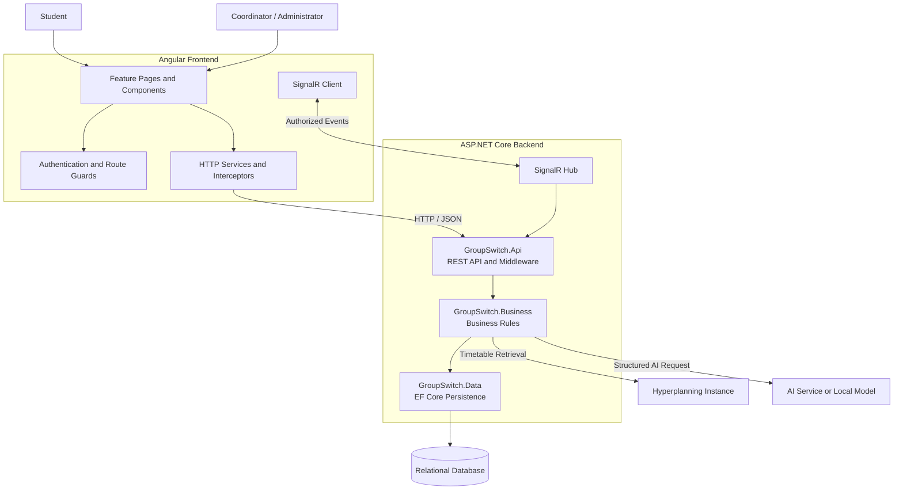
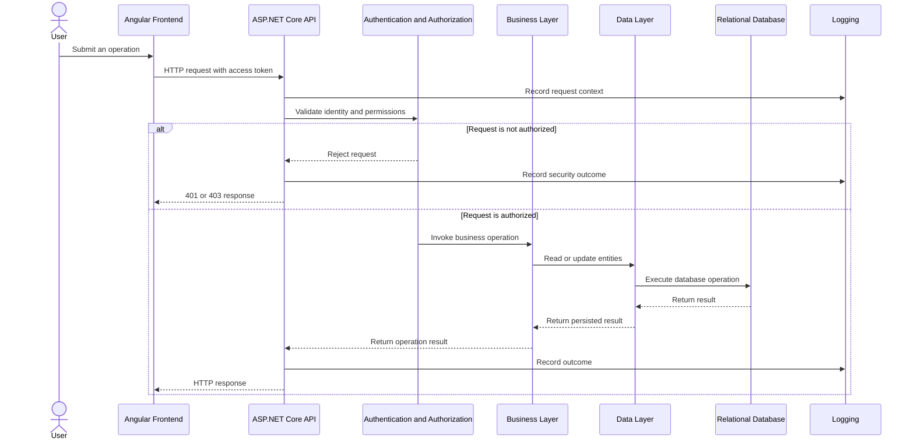
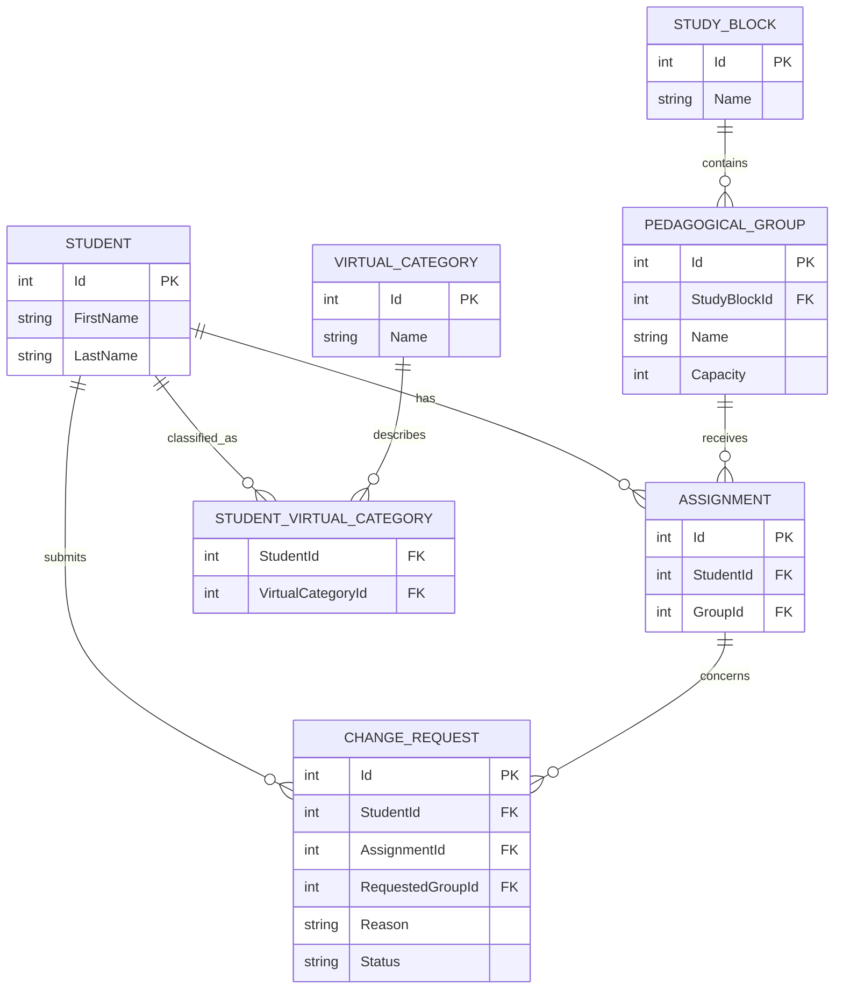
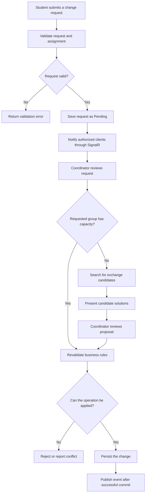
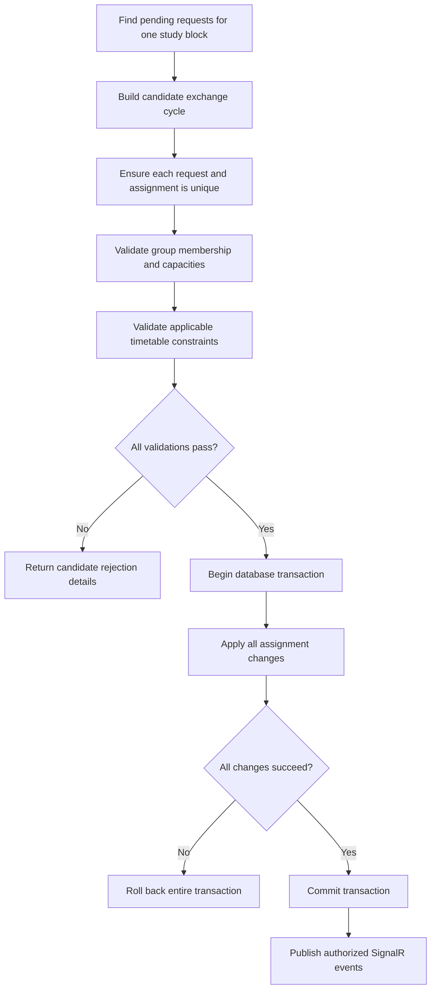
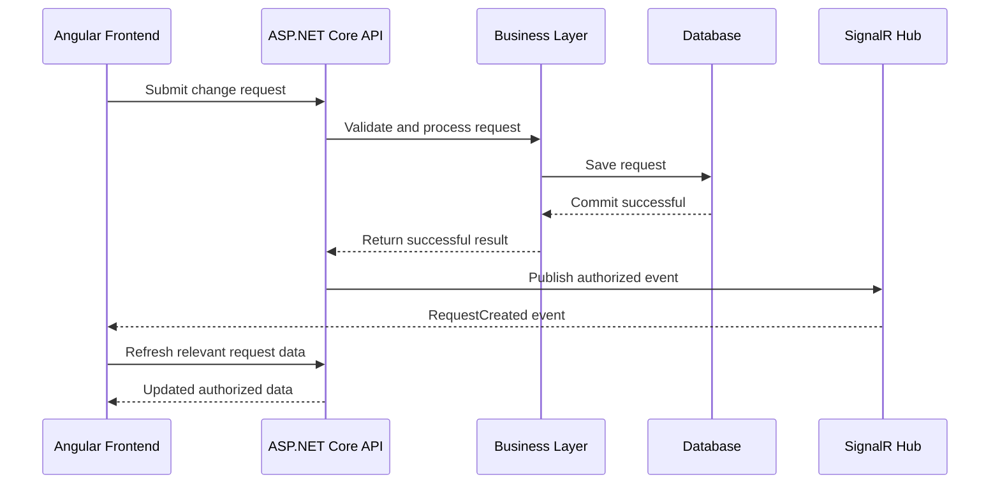

# GroupSwitch v1.1 — Architecture and System Diagrams

## 1. Purpose

This document describes the architecture of GroupSwitch v1.1, a web application designed to manage students, study blocks, pedagogical groups, assignments, change requests, and exchange proposals.

It documents the responsibilities of the frontend and backend, the main business workflows, external integrations, security boundaries, and logging requirements.

The architecture follows the client requirements and the current repository structure.

**Implementation status:** This document describes the target architecture. Each component and mechanism must be verified against the actual source code before being considered implemented.

## 2. Project Structure

```text
GroupSwitch/
├── backend/
│   ├── GroupSwitch.Api/
│   ├── GroupSwitch.Business/
│   ├── GroupSwitch.Data/
│   └── GroupSwitch.Tests/
│
├── frontend_angular/
│   ├── src/
│   │   └── app/
│   │       ├── core/
│   │       ├── layout/
│   │       ├── features/
│   │       ├── shared/
│   │       ├── app.routes.ts
│   │       └── app.config.ts
│   └── package.json
│
├── docs/
│   └── architecture.md
│
└── GroupSwitch.sln
```

### 2.1. Backend projects

| Project                | Responsibility                                                                                                                                                  |
| ---------------------- | --------------------------------------------------------------------------------------------------------------------------------------------------------------- |
| `GroupSwitch.Api`      | REST endpoints, HTTP configuration, JWT authentication, authorization, SignalR Hub, middleware, and API error handling.                                         |
| `GroupSwitch.Business` | Business rules, assignment management, capacity validation, change requests, exchange search, timetable conflict detection, and AI-assisted candidate analysis. |
| `GroupSwitch.Data`     | EF Core database access, entity configurations, migrations, and persistence-related implementations.                                                            |
| `GroupSwitch.Tests`    | Automated tests for business rules, persistence, API behaviour, security, and critical workflows.                                                               |

### 2.2. Angular frontend

| Folder          | Responsibility                                                                                                         |
| --------------- | ---------------------------------------------------------------------------------------------------------------------- |
| `core/`         | Application-wide services, authentication, HTTP interceptors, guards, and configuration-related functionality.         |
| `layout/`       | Main layouts, navigation, and application shell.                                                                       |
| `features/`     | Business features such as students, groups, assignments, change requests, exchanges, timetable conflicts, and exports. |
| `shared/`       | Reusable components, pipes, directives, and shared presentation elements.                                              |
| `app.routes.ts` | Application route definitions.                                                                                         |
| `app.config.ts` | Angular application providers and configuration.                                                                       |

The frontend is responsible for presentation and user interaction. It must not be the authoritative source for business rules or access control.

## 3. High-Level Architecture



### 3.1. Architecture principles

- **Separation of concerns:** Each project has a clear responsibility.
- **Backend authority:** Business rules and authorization are enforced by the backend.
- **Independent assignments:** A student can have assignments in several study blocks.
- **Data integrity:** Critical changes must preserve assignment, capacity, and exchange invariants.
- **Deterministic validation:** Timetable conflicts and capacity checks are calculated by backend code, not by AI.
- **External integration isolation:** Hyperplanning and AI integrations must be separated from core business rules.
- **Testability:** Business rules should be testable without requiring the Angular interface or a live AI provider.
- **Observability:** Relevant operations, errors, and integration failures should be logged without exposing secrets or unnecessary personal data.

## 4. Backend Request Flow

A typical request passes through the API before reaching the business rules and persistence layer.



The logging component in this diagram represents a cross-cutting concern. It can be implemented using ASP.NET Core logging, middleware, and application-specific logging calls.

The exact logging points and the information recorded must be configured in the implementation.

## 5. Domain Model and Assignment Relationships

A student can belong to several pedagogical groups, provided those assignments concern different study blocks.

An assignment represents the relationship between one student and one pedagogical group.



This diagram presents the main conceptual relationships. It is not a substitute for the actual EF Core entity definitions and database constraints.

### 5.1. Assignment invariants

The backend must enforce the following rules:

1. Every assignment references an existing student and group.
2. A student can have assignments in different study blocks simultaneously.
3. A student must not have more than one active assignment in the same study block.
4. A change request concerns one specific assignment.
5. Accepting a change must not modify the student's assignments in other blocks.
6. A group's capacity must not be exceeded.
7. Virtual categories describe a student's administrative or educational situation; they do not replace real pedagogical assignments.

These rules should be implemented in the business layer and protected by appropriate database constraints where possible.

## 6. Change Requests and Exchange Workflow

### 6.1. Processing a normal change request



The precise status transitions must be defined in the business rules and documented in `api-contract.md`.

### 6.2. Atomic exchange cycle

The backend must support an exchange involving at least three students.



The operation must either apply all assignment changes or apply none. The backend must also handle concurrent updates that could invalidate the proposal between validation and persistence.

## 7. External Integrations

### 7.1. Hyperplanning

A dedicated component or service must retrieve data from the targeted Hyperplanning instance.

Its responsibilities include:

- Accessing the configured instance using an approved and documented method.
- Retrieving relevant timetable information.
- Parsing the retrieved data into an internal representation.
- Identifying activities, sessions, dates, start times, end times, and relevant groups.
- Reporting retrieval or parsing failures clearly.

The business layer then uses the internal timetable representation to detect overlapping sessions.

For two sessions to be considered overlapping, their dates must correspond and their time intervals must intersect according to the documented conflict rule.

The AI must not determine whether two sessions overlap. This decision belongs to deterministic backend logic.

### 7.2. AI-assisted analysis

The AI service is used to interpret the free-text reason attached to a change request.

Its output should contain structured fields such as:

- Summary.
- Preferences.
- Explicitly declared constraints.
- Uncertainties or ambiguities.
- Activities to consider.
- Information that requires verification.

The backend validates and normalizes the result before using it to search for candidate solutions.

The backend must independently verify capacity, assignment consistency, and timetable compatibility. The AI must never directly change assignments or make the final decision.

AI service failures must not prevent normal request consultation and processing.

## 8. SignalR Communication

SignalR provides real-time notifications. REST remains responsible for ordinary data retrieval and modification.

A proposed event flow is:



The event should identify the relevant request and study block, without disclosing unnecessary student information.

The application must:

- Authenticate SignalR connections.
- Restrict event recipients according to their permissions.
- Prevent clients from joining unauthorized groups.
- Handle connection loss and reconnection.
- Publish events only after the corresponding business operation succeeds.

The event names and payloads must be documented in the implementation and API documentation.

## 9. Logging and Application Observability

### 9.1. Objectives

Logging is intended to support troubleshooting, maintenance, security investigations, and verification of critical business workflows.

It should help developers determine:

- Which operation failed.
- When the failure occurred.
- Which application component was involved.
- Whether the request was rejected by validation, authorization, persistence, or an external integration.
- Whether a critical transaction succeeded or failed.
- Whether Hyperplanning or the AI service was unavailable.

Logging must not be used as a substitute for proper exception handling, automated tests, or access control.

### 9.2. Recommended implementation

Use the built-in `ILogger<T>` abstraction provided by ASP.NET Core.

This allows each component to write logs without depending directly on a particular logging provider.

A proposed initial approach is:

- Use structured logging with named properties.
- Use `Information` for important successful operations.
- Use `Warning` for recoverable failures and rejected operations that need investigation.
- Use `Error` for failed operations and unexpected exceptions.
- Use `Critical` only for severe failures that threaten application availability or data integrity.
- Use `Debug` for development diagnostics, avoiding verbose production logs.
- Configure log levels separately for development, testing, and production.
- Consider a structured logging provider such as Serilog if file sinks, centralized collection, or additional production features are needed.

The logging provider and storage destination should be chosen according to the actual deployment environment.

### 9.3. Suggested logging locations

| Component                 | Events to log                                                                                                                      |
| ------------------------- | ---------------------------------------------------------------------------------------------------------------------------------- |
| API middleware            | Unexpected request failures, unhandled exceptions, request duration, and correlation identifiers.                                  |
| Authentication            | Relevant authentication failures and authorization denials, without recording credentials or tokens.                               |
| Business layer            | Important workflow outcomes, failed business validations, and exchange-processing failures.                                        |
| Data layer                | Database operation failures and transaction errors, without logging sensitive SQL parameters.                                      |
| Hyperplanning integration | Retrieval start and outcome, parsing failures, and integration duration.                                                           |
| AI integration            | Provider availability, request outcome, response validation failures, and duration. Do not log unnecessary prompt or student data. |
| SignalR                   | Relevant connection failures, publication failures, and authorization-related problems.                                            |
| Export services           | Export format, selected scope, outcome, and generation failures. Avoid logging exported student lists.                             |

Logging a successful operation does not itself prove that the operation is correct. The persisted state and automated tests remain the source of verification.

### 9.4. Structured log example

An application log should record named fields rather than constructing an unstructured sentence.

Example:

```csharp
_logger.LogInformation(
    "Change request {RequestId} processed with status {Status}",
    requestId,
    status);
```

For a failure:

```csharp
_logger.LogError(
    exception,
    "Failed to process exchange {ExchangeId}",
    exchangeId);
```

These examples illustrate the recommended pattern. The actual logger field names and call locations must match the implementation.

### 9.5. Correlation identifiers

A correlation identifier helps connect log entries belonging to the same request.

The API should use an established request-tracing mechanism or implement a consistent correlation-ID middleware.

If a client-supplied correlation ID is accepted, it must be validated before being used in logs or response headers. The application should otherwise generate a trusted identifier.

The identifier should be included in relevant log scopes and, where appropriate, returned to the client so a reported error can be investigated.

Do not use a student's name, email address, or other personal identifier as a correlation ID.

### 9.6. Logging and sensitive information

The application must never log:

- Plain-text passwords.
- JWT access tokens or refresh tokens.
- JWT signing keys or AI API keys.
- Database credentials.
- Unnecessary personal student data.
- Full authentication headers.
- Sensitive AI prompts or responses containing personal information.

Log messages and externally returned errors must not expose stack traces, secret configuration, or internal implementation details.

Logs must be protected against unauthorized access. Retention and deletion periods should be defined according to the deployment context and applicable privacy requirements.

### 9.7. Error handling

The API should use centralized exception handling and a consistent error response format, preferably Problem Details.

Expected business failures should be represented as controlled responses. Unexpected exceptions should be logged with their exception details on the server, while the client receives a safe and understandable error response.

The API should distinguish validation errors, authentication failures, authorization failures, missing resources, business conflicts, and unexpected server failures.

Do not log the same exception at every layer without adding useful context. This creates noise and makes troubleshooting harder.

### 9.8. Minimum logging verification

The implementation should be tested to confirm that:

1. An unexpected API exception is logged.
2. The response does not expose an internal stack trace.
3. A critical exchange failure is recorded with a useful correlation identifier.
4. Hyperplanning retrieval failures are distinguishable from actual timetable conflicts.
5. AI response-validation failures are logged without unnecessary personal data.
6. Sensitive credentials and authentication tokens are not written to logs.
7. Logging failures do not cause a business transaction to be partially applied.

## 10. Security Boundaries

The backend must enforce authentication, authorization, and business validation for every protected operation.

The minimum roles are:

- **Student:** may access permitted information and manage their own change requests.
- **Coordinator / Administrator:** may manage students, study blocks, groups, assignments, virtual categories, requests, exchanges, and exports according to the assigned permissions.

The implementation must also protect SignalR events, imported files, exported data, and external integration credentials.

Angular route guards and hidden buttons are usability mechanisms, not security controls. Direct API requests must be subject to the same backend authorization rules.

## 11. Testing Strategy

Tests should be organized according to the responsibilities of the architecture.

### Business tests

- Group capacity validation.
- Multiple assignments across different blocks.
- Single active assignment per student within one block.
- Change requests affecting only the intended assignment.
- Exchange cycles involving at least three students.
- Complete rollback when an exchange fails.
- Deterministic timetable conflict detection.
- AI criteria validation and candidate-search behaviour.

### Data and API integration tests

- EF Core persistence and relationship constraints.
- API validation and error responses.
- JWT authentication and role authorization.
- Protection against access to another student's requests.
- CSV and PDF export scope and content.
- SignalR event authorization and successful publication.
- Logging and exception-handling behaviour.

### External integration tests

Use controlled test doubles or fixtures for ordinary automated tests.

Separate integration tests should verify the actual Hyperplanning retrieval and AI service integration where suitable credentials and environments are available.

A successful unit test using sample timetable data must not be presented as proof that real Hyperplanning scraping works.

## 12. Operational and Maintenance Considerations

The application should provide enough diagnostic information to investigate failures without exposing sensitive information.

Recommended operational measures include:

- Environment-specific configuration.
- Secrets stored outside the Git repository.
- Database migration and recovery procedures.
- Appropriate health checks.
- Defined log levels and retention.
- Documented procedures for Hyperplanning and AI integration failures.
- Verification of critical workflows after deployment.
- Automated tests before changes are merged.

Backups, deployment procedures, and recovery steps must be adapted to the actual hosting environment rather than documented as completed before they exist.

## 13. Architecture Decisions to Confirm

The following decisions must be confirmed against the codebase and the deployment requirements:

- The exact .NET version and EF Core database provider.
- The actual dependency direction between the four backend projects.
- The final entity and relationship definitions.
- The selected JWT and account-management implementation.
- The Hyperplanning access method and supported timetable data.
- The AI provider or local model and its structured response schema.
- The SignalR event names and recipient rules.
- The logging provider, output destination, and retention policy.
- The API error contract and correlation-ID mechanism.
- The deployment, backup, and recovery strategy.


**Document status:** Architecture reference for GroupSwitch v1.1. Update this document whenever a significant architecture decision or implementation detail changes.
