# GroupSwitch — Software Architecture & Technical Documentation

**Project:** GroupSwitch
**Frontend:** Angular
**Backend:** ASP.NET Core / C#
**Database:** Relational database — provider to be confirmed
**Real-time communication:** SignalR
**External integrations:** Hyperplanning and AI service/model
**Testing:** Automated backend tests and integration tests

> **Documentation status:** Architecture proposal based on the project requirements. The diagrams describe the target design and must be checked against the actual source code before being considered implemented or verified.

---

## 1. Project Overview

GroupSwitch is a web application designed to manage students, pedagogical activities, study blocks, group assignments, and requests to change groups.

The application must enforce business rules, validate group capacities, detect timetable conflicts, support exchanges between multiple students, and provide authorized data imports and exports.

The system uses an Angular frontend and an ASP.NET Core backend. Business rules are validated by the backend, and persistent data is stored in a relational database.

The application also includes integration requirements for Hyperplanning, AI-assisted preference extraction, and SignalR notifications.

### Main objectives

- Manage students, study blocks, pedagogical groups, and assignments.
- Allow students to submit change requests concerning their assignments.
- Allow authorized coordinators to review and decide requests.
- Support exchanges involving three or more students with atomic transaction handling.
- Detect timetable conflicts deterministically in C#.
- Import data from CSV files while reporting invalid rows.
- Export authorized data to CSV and PDF.
- Use AI to extract structured preferences without delegating business decisions to the AI.
- Notify authorized users of relevant updates through SignalR.
- Maintain security, traceability, reliability, and automated test coverage.

---

## 2. System Architecture

The application is organized into four existing backend projects and an independent Angular frontend.

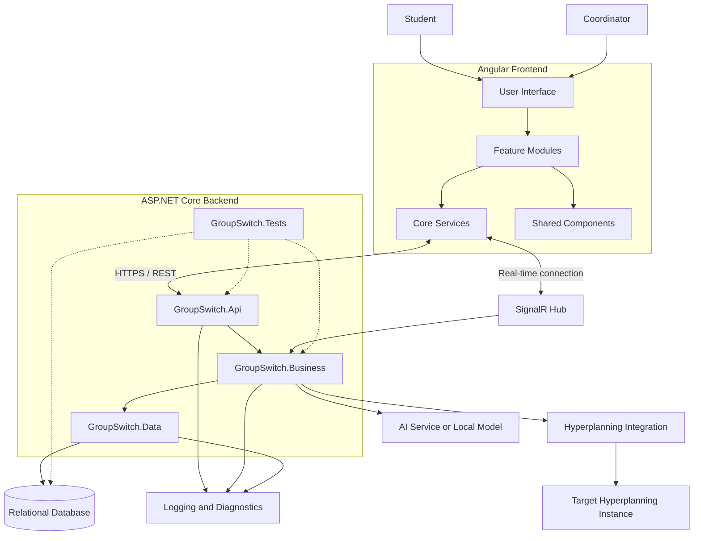

### Architecture responsibilities

| Component | Responsibility |
|---|---|
| Angular frontend | User interface, navigation, forms, and user feedback |
| `GroupSwitch.Api` | HTTP endpoints, request/response contracts, authentication, authorization, and SignalR |
| `GroupSwitch.Business` | Application workflows, domain rules, validation, and transaction orchestration |
| `GroupSwitch.Data` | Persistence, database mappings, queries, and transaction support |
| `GroupSwitch.Tests` | Automated tests for business rules, API behavior, security, and integrations |
| Relational database | Persistent storage of application data |
| Hyperplanning integration | Retrieval of timetable information |
| AI integration | Extraction of structured preferences and constraints from free text |
| SignalR | Authorized real-time notifications |
| Logging | Diagnostics, error investigation, and operation traceability |

---

## 3. Use Case Diagram

This diagram describes the main interactions between the application's users and its functionalities.

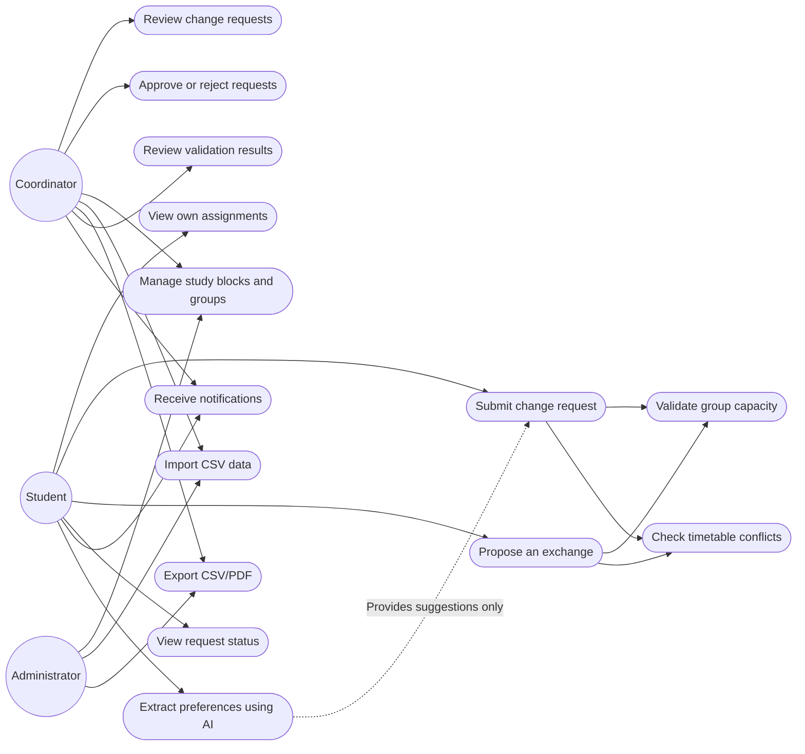

### Use case descriptions

| Use case | Description |
|---|---|
| View own assignments | A student consults their assignments and associated groups. |
| Submit change request | A student submits a request concerning a specific assignment. |
| Propose an exchange | A user proposes a potential exchange, subject to validation and authorization. |
| Review change requests | An authorized coordinator examines pending requests. |
| Approve or reject | An authorized coordinator makes a decision according to the agreed workflow. |
| Manage study blocks and groups | An authorized user manages the relevant pedagogical structures. |
| Import CSV data | The system processes input data and reports row-level errors. |
| Export CSV/PDF | The backend generates an authorized export with the correct scope. |
| Validate capacity | The backend checks whether the target group has available capacity. |
| Check timetable conflicts | Deterministic backend logic checks relevant timetable intervals. |
| Extract preferences using AI | An AI service proposes structured preferences that must be validated by the backend. |

**Security principle:** hiding a button in Angular is not authorization. Every protected action must be checked by the backend.

---

## 4. Backend Architecture Diagram

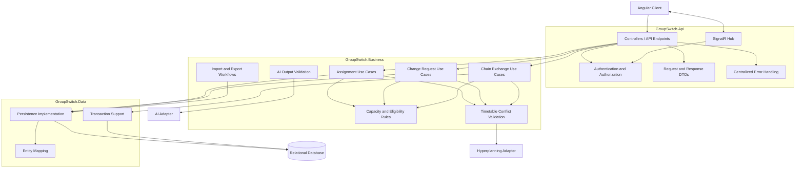

### Backend design principles

1. Controllers should handle HTTP concerns, not contain the full business logic.
2. Business rules should be centralized and testable independently.
3. Database access should remain within the data-access boundary.
4. External integrations should be isolated behind interfaces or adapters.
5. Authorization must be enforced server-side.
6. Multi-record operations must use appropriate transaction and concurrency safeguards.
7. Exceptions must be logged safely and returned as controlled API errors.

The exact interfaces, class names, and dependency references must be adapted to the implementation.

---

## 5. Frontend Architecture Diagram

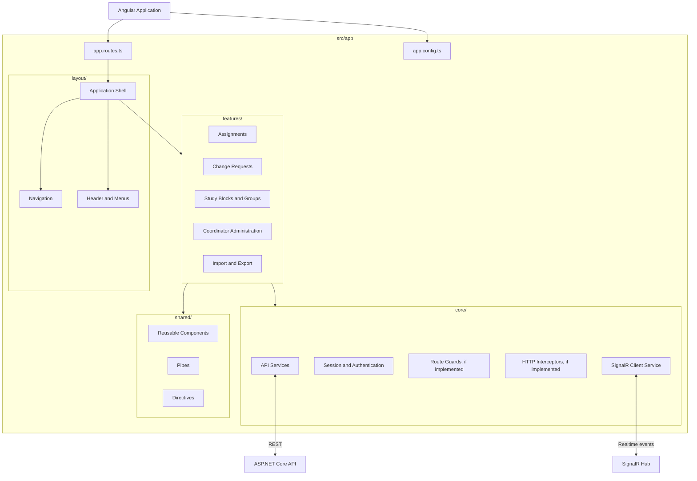

### Frontend responsibilities

- Display the application screens and navigation.
- Collect user input and provide understandable validation feedback.
- Call the backend using typed API services.
- Display server-authoritative business validation results.
- Receive authorized SignalR notifications.
- Handle loading, empty, success, and error states.
- Avoid embedding secrets or trusting client-side authorization alone.

The feature names above are a proposed organization of the required functionality, not a claim that all these modules already exist.

---

## 6. Domain Class Diagram

The following diagram presents a conceptual domain model. Confirm the entity names, properties, and relationships against the actual C# classes before implementation.

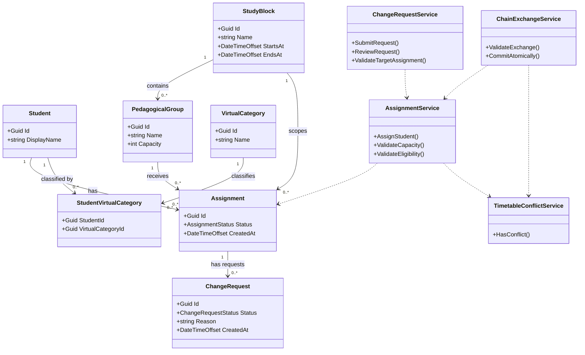

### Important domain rules

- A student may have assignments in several study blocks.
- A student may have at most one active assignment per study block.
- A change request refers to a specific assignment.
- A group must not exceed its configured capacity.
- An assignment must refer to a group belonging to the same study block.
- Chain exchanges involving three or more students must succeed or fail as a whole.
- AI suggestions must not bypass the business validation services.

---

## 7. Entity-Relationship Diagram

This is the conceptual database model, not a final database schema or migration.

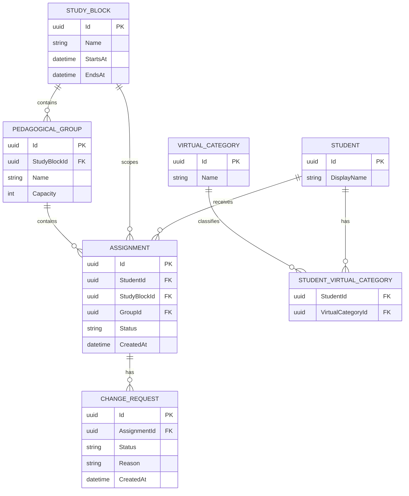

### Database integrity

The database should use foreign keys, unique constraints, indexes, and transactions where appropriate.

Recommended constraints and checks include:

- Valid references between assignments, students, study blocks, and groups.
- Protection against duplicate active assignments for the same student and study block.
- Capacity validation under concurrent operations.
- Consistent relationships between groups and their study blocks.
- Atomic persistence for chain exchanges.
- Appropriate indexes for common assignment and request queries.

The exact constraints depend on the chosen database provider, status model, and schema. Application validation alone may not be sufficient under concurrent requests.

---

## 8. Sequence Diagram — Submit a Change Request

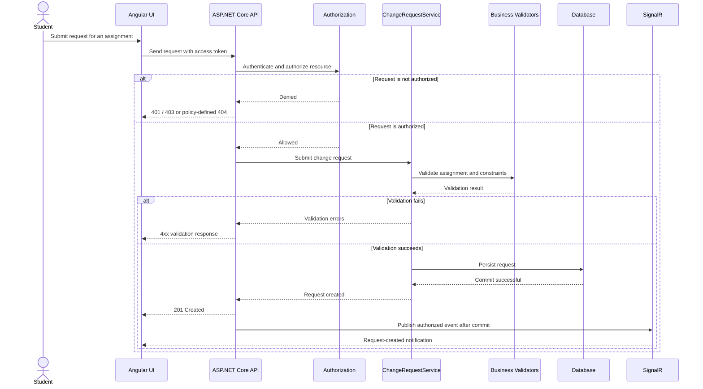

### Explanation

1. The student submits a request from Angular.
2. The API authenticates the user and checks access to the assignment.
3. The business layer validates the requested operation.
4. If validation fails, the API returns an appropriate error.
5. If validation succeeds, the request is persisted.
6. A real-time notification is sent only after successful persistence.

The exact status codes and workflow states must match the implemented API contract.

---

## 9. Sequence Diagram — Chain Exchange

A chain exchange involving three or more students must be atomic.

```mermaid
sequenceDiagram
    actor Coordinator
    participant UI as Angular UI
    participant API as ASP.NET Core API
    participant Service as ChainExchangeService
    participant Rules as Business Validators
    participant DB as Database Transaction
    participant Hub as SignalR

    Coordinator->>UI: Confirm chain exchange
    UI->>API: Submit exchange command
    API->>Service: Execute exchange

    Service->>Rules: Validate all participants and assignments
    Rules-->>Service: Validation result

    alt At least one validation fails
        Service-->>API: Reject exchange
        API-->>UI: Validation error; no changes committed
    else All validations succeed
        Service->>DB: Begin transaction
        Service->>DB: Apply all assignment changes
        Service->>DB: Save and commit

        alt Persistence or concurrency failure
            DB-->>Service: Failure
            Service->>DB: Roll back transaction
            Service-->>API: Exchange failed
            API-->>UI: Error response
        else Commit succeeds
            DB-->>Service: Transaction committed
            Service-->>API: Exchange successful
            API-->>UI: Success response
            API->>Hub: Publish scoped event after commit
        end
    end
```

### Atomicity requirements

- Validate every participant and assignment.
- Recheck capacity and relevant constraints.
- Persist all required changes in a single transaction where supported.
- Roll back all changes if any operation fails.
- Do not send success notifications before commit.
- Test both successful exchanges and rollback scenarios.

---

## 10. Business Flow — Assignment Validation

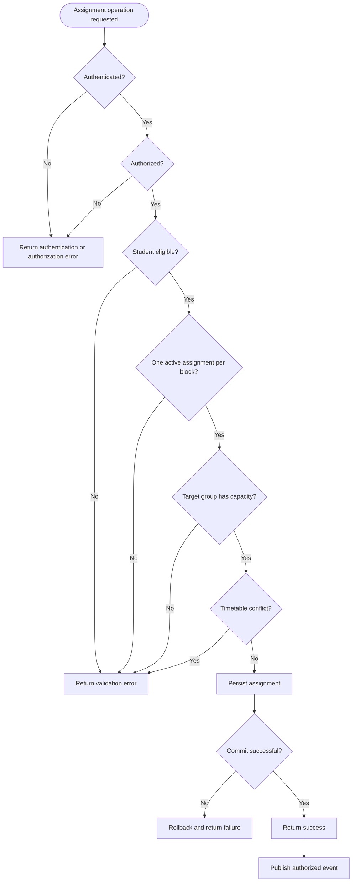

This flow is illustrative. The exact validation order and assignment-creation permissions must be confirmed against the business requirements.

---

## 11. State Machine — Change Request

The following states illustrate a possible lifecycle. They must be reconciled with the final business workflow and actual status enum.

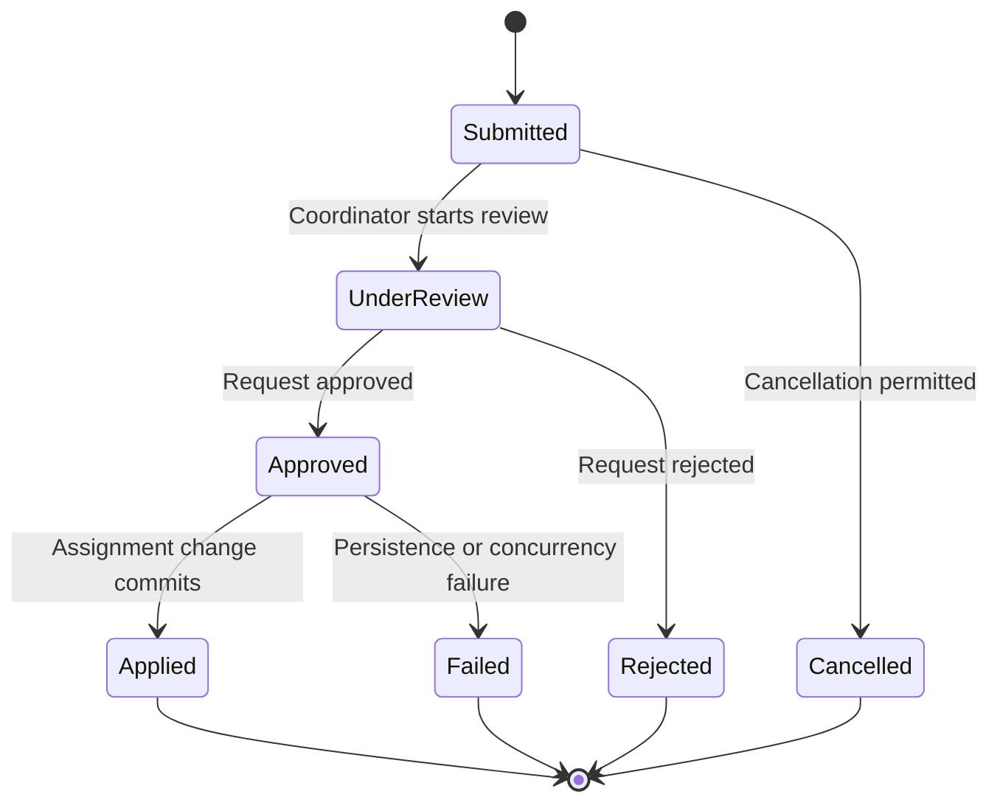

### State transition rules

- Only authorized users may perform restricted transitions.
- A request must not be approved twice in a way that duplicates changes.
- An assignment update must follow the approved business workflow.
- A failed persistence operation must not leave the assignment partially modified.
- The system should define how stale requests and concurrent decisions are handled.

---

## 12. Data Flow — CSV Import and Export

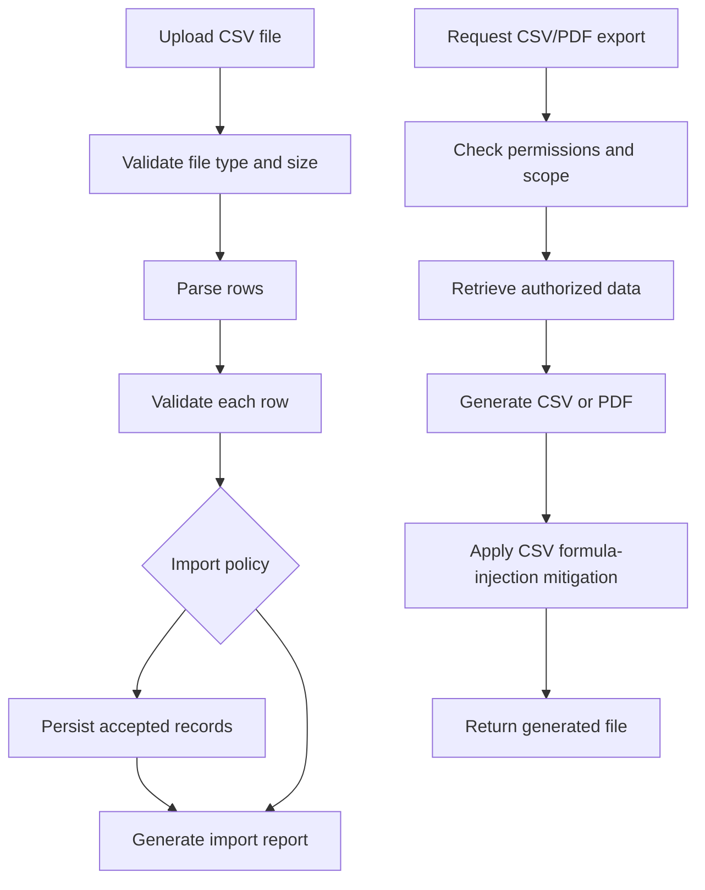

### Import requirements

- Validate the file and its contents.
- Report invalid rows clearly.
- Handle duplicates according to an agreed policy.
- Define whether valid rows are imported when other rows are invalid.
- Avoid leaving partially applied data when the chosen import policy requires atomicity.

### Export requirements

- Enforce authorization and resource scope in the backend.
- Include empty groups where required.
- Preserve accented names and text encoding.
- Mitigate CSV formula injection.
- Test PDF pagination and readability.
- Avoid generating exports containing unauthorized data.

---

## 13. External Integrations

### Hyperplanning

The Hyperplanning integration retrieves timetable information for the targeted instance.

The backend must perform deterministic timetable conflict validation. The integration should be isolated behind an adapter or service interface.

The implementation must define:

- The permitted access method.
- Authentication and session management.
- The data mapping to internal timetable slots.
- Time zone and date/time handling.
- Timeout and retry behavior.
- How missing or stale data is handled.
- Integration tests using controlled test data.

The integration must not be considered operational until retrieval has been tested against the actual permitted target.

### AI-assisted preference extraction

AI may extract structured preferences or constraints from free text.

The backend remains responsible for validating the result and enforcing all business rules. AI output must never bypass authorization, capacity checks, timetable checks, or transaction rules.

The implementation should handle:

- Invalid or malformed output.
- Timeouts and unavailable services.
- Unexpected output structures.
- Local-model or external-provider failures.
- Data minimization and credential protection.

AI failure should not prevent normal non-AI workflows from operating.

### SignalR

SignalR communicates relevant updates to authorized clients.

- REST remains the primary interface for CRUD operations.
- Hub connections and subscriptions require authorization.
- Events should be published only after successful persistence.
- Sensitive data must not be broadcast to unrelated users.
- Clients should be able to refresh authoritative state through the API.

---

## 14. Testing Architecture

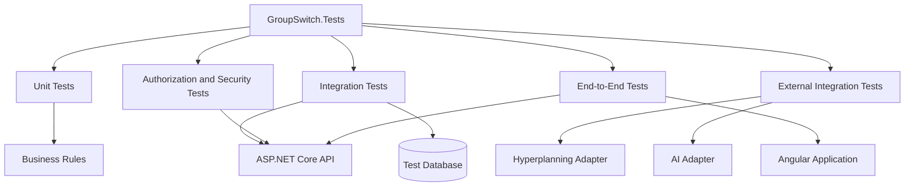

### Test levels

| Test level | Purpose | Examples |
|---|---|---|
| Unit tests | Verify isolated business rules | Capacity validation, eligibility, timetable conflicts |
| Integration tests | Verify interactions between components | API and database persistence, transaction rollback |
| Security tests | Verify access restrictions | Unauthorized resource access, role permissions |
| External integration tests | Verify adapter behavior | Hyperplanning timeout, invalid AI output |
| End-to-end tests | Verify complete user journeys | Submit request, review decision, observe result |
| Regression tests | Prevent previously fixed defects from returning | Reproduce a known failure |

### Minimum business test scenarios

**Assignments**

- A valid assignment is accepted.
- A full group rejects another assignment.
- A student cannot have two active assignments in the same study block.
- A student can have assignments in different study blocks.
- An assignment cannot reference a group from another study block.
- Concurrent requests cannot overfill a group.

**Change requests**

- A student can request a change for an authorized assignment.
- A student cannot access another student's protected assignment.
- An invalid target is rejected.
- A rejected request does not modify the assignment.
- Repeated or stale decisions are handled safely.

**Chain exchanges**

- A valid exchange involving three or more students commits all changes.
- An invalid participant causes the entire operation to fail.
- A persistence failure rolls back all changes.
- Concurrent operations cannot bypass capacity constraints.
- No success notification is sent after a failed transaction.

**Import/export**

- Invalid CSV rows are reported.
- Duplicate rows follow the documented policy.
- Accented names are preserved.
- Formula-like CSV values are handled safely.
- PDF pagination is tested.
- Unauthorized exports are denied.

**AI and SignalR**

- Valid AI output is parsed and validated.
- Malformed output and timeouts are handled safely.
- An AI suggestion that violates a business rule is rejected.
- Authorized clients receive the relevant event.
- Unauthorized clients do not receive protected events.

### Definition of done for tests

A test is not considered passed simply because it has been written. Record the test command, execution environment, result, and relevant evidence.

---

## 15. Logging and Monitoring

Logging should make it possible to investigate failed requests, business-operation failures, integration outages, and transaction problems without exposing secrets or unnecessary personal data.

### Recommended baseline

Use `Microsoft.Extensions.Logging.ILogger<T>` as the initial logging abstraction. Add a provider such as Serilog only if the project requires its additional capabilities.

Example:

```csharp
public sealed class ChangeRequestService
{
    private readonly ILogger<ChangeRequestService> _logger;

    public ChangeRequestService(
        ILogger<ChangeRequestService> logger)
    {
        _logger = logger;
    }

    public async Task ProcessAsync(
        Guid requestId,
        CancellationToken cancellationToken)
    {
        _logger.LogInformation(
            "Processing change request {ChangeRequestId}",
            requestId);

        // Validate business rules.
        // Persist the operation.
        // Confirm that the transaction has committed.

        _logger.LogInformation(
            "Change request {ChangeRequestId} processed",
            requestId);
    }
}
```

This is an illustrative example. Adapt it to the actual service method and transaction workflow. Do not log success before persistence has succeeded.

### Log levels

| Level | Appropriate use |
|---|---|
| Trace / Debug | Detailed development diagnostics |
| Information | Important successful operations |
| Warning | Handled anomalies, rejected operations, or recoverable integration problems |
| Error | Failed operations, unexpected exceptions, or transaction failures |
| Critical | Severe failures requiring immediate attention |

### Recommended logging points

- HTTP request duration and status.
- Authentication and authorization failures.
- Assignment creation and modification.
- Change-request submission and decision.
- Chain-exchange success or rollback.
- CSV import and export results.
- Hyperplanning and AI integration failures.
- Unexpected exceptions and concurrency conflicts.

### Sensitive data that must not be logged

- Passwords.
- JWTs and bearer tokens.
- API keys and connection strings.
- Full request bodies containing personal information.
- Complete student lists when unnecessary.
- Sensitive external-service responses.

Use structured fields such as operation name, correlation ID, resource identifier, duration, and result category where appropriate.

### Correlation and errors

A correlation or trace identifier should connect the API response to the relevant server logs.

Unexpected failures should return a generic error response with a correlation identifier. Stack traces and internal exception details belong in protected server logs, not in client responses.

---

## 16. Security Architecture

Security must be enforced by the backend, not only by the Angular interface.

### Authentication and authorization

- Protected endpoints require an authenticated identity.
- Student and coordinator permissions must be distinguished.
- Resource-level authorization must prevent unauthorized access to another student's data.
- Import, export, administrative actions, and SignalR subscriptions must enforce their own permissions.
- The API must not trust role or ownership fields supplied by the client.

### API error handling

| Situation | Expected behavior |
|---|---|
| No valid authentication | `401 Unauthorized` |
| Authenticated but forbidden | `403 Forbidden`, or a consistent policy-defined `404` |
| Resource not found | `404 Not Found` |
| Invalid input | Appropriate `4xx` response |
| Unexpected server failure | Generic `500` response with correlation ID |

The exact error response format should be defined in the API contract.

---

## 17. Deployment Architecture

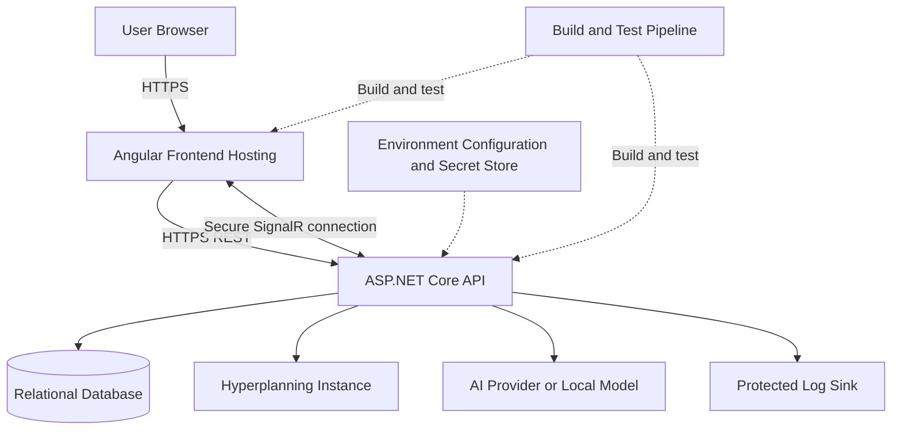

### Deployment considerations

- Configure separate development, test, and production environments where applicable.
- Keep credentials out of source control.
- Use HTTPS for deployed application traffic.
- Configure database access with least privilege.
- Apply database migrations through a controlled process.
- Define log retention and access policies.
- Test startup configuration and integration failure handling.
- Document backup, recovery, and deployment procedures.

The actual hosting provider, database technology, CI/CD platform, and AI deployment model remain to be confirmed.

---

## 18. Architecture Decisions to Confirm

The following questions must be resolved before the diagrams are treated as the final architecture.

1. Which relational database and provider are used?
2. Are the proposed entity names consistent with the actual C# models?
3. What are the exact assignment and change-request status values?
4. How is the one-active-assignment-per-block rule enforced?
5. Where is timetable data stored, and how often is it refreshed?
6. What is the permitted Hyperplanning access mechanism?
7. Which AI service or local model is used?
8. Which API endpoints and DTOs have actually been implemented?
9. What is the exact CSV partial-import policy?
10. Which users may export data for each study block?
11. Which logging provider and retention policy are selected?
12. How are database migrations, deployment, and recovery managed?

---

## 19. Documentation Status Convention

Use these labels consistently in the project documentation:

| Status | Meaning |
|---|---|
| Proposed | Recommended design, not yet confirmed |
| Confirmed | Agreed design decision |
| In progress | Implementation has started |
| Implemented | Corresponding code exists |
| Verified | Behavior has been demonstrated by tests or documented verification |
| Deferred | Explicitly postponed |

**Important:** A diagram does not prove that the corresponding functionality exists. Update this documentation as the actual code, database schema, endpoints, and tests evolve.

---

**End of document.**
